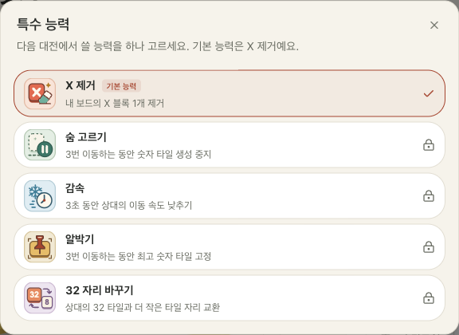

# 능력 5종 적용 · 2026-10-16

기본 X 1개 제거, 숨 고르기, 감속, 알박기, 상대 32 자리 바꾸기를 서버 판정으로 구현했다. 충전은 병합 점수 누적 1024, 최대 1회분이며 경기 시작 시 0이다. 게스트는 X 제거를 사용하고 로그인 계정은 5종 중 선택한다. 아이콘 SVG는 `apps/web/public/ability-icons/`에 있다.

- `pnpm test`: 게임·소켓·설정·DB·튜토리얼 등 104개 및 공통 언어 테스트 2개 통과.
- `pnpm typecheck`, `pnpm lint`, `pnpm build`: 게임 웹·대전 서버 타입 검사, 웹·관리자 린트와 프로덕션 빌드 통과.
- `loadout.browser.mjs`: 기본 능력, 게스트 잠금, 5개 목록, 계정 선택·저장·재방문 2개 시나리오 통과.
- `abilities.browser.mjs`: 한국어·영어 튜토리얼 6단계 완주·재시작·키보드 초점, 별도 로컬 소켓 서버에서 5종 모두 충전 후 버튼으로 실제 발동하는 2개 시나리오 통과. 폭 1440·375·320px에서 가로 넘침과 버튼 크기를 확인했다. 모의 계정과 별도 서버를 사용해 운영 전적은 기록하지 않았다.
- `20261015181708_five_abilities.sql`: 연결된 Supabase에 적용하고 허용 목록 확인. 기존 선택 행·이전 ID와 설정 권한은 보존한다.

튜토리얼: [한국어](tutorial-ko.png), [영어](tutorial-en.png).
실전: [X 제거](live-clear-x.png), [생성 중지](live-spawn-pause.png), [감속](live-frost-wave.png), [알박기](live-anchor-tile.png), [32 교환](live-swap-32.png).

운영 배포와 실제 휴대폰·스크린리더·장기 밸런스 테스트는 하지 않았다. 모바일 튜토리얼은 세로 스크롤을 사용한다. 충전량과 지속시간은 플레이테스트용 초기 값이다.
